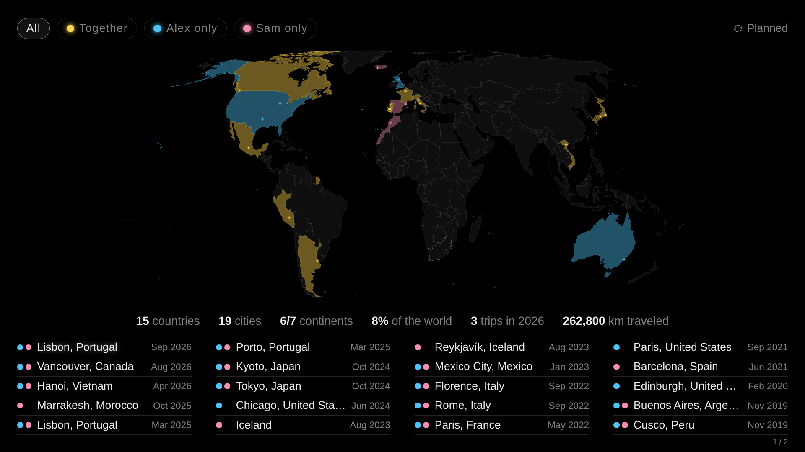
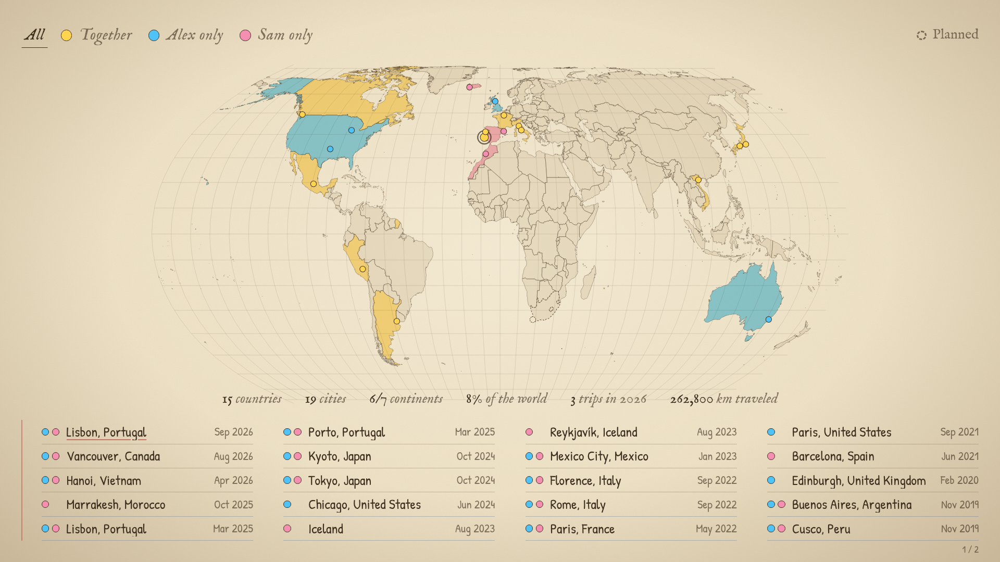
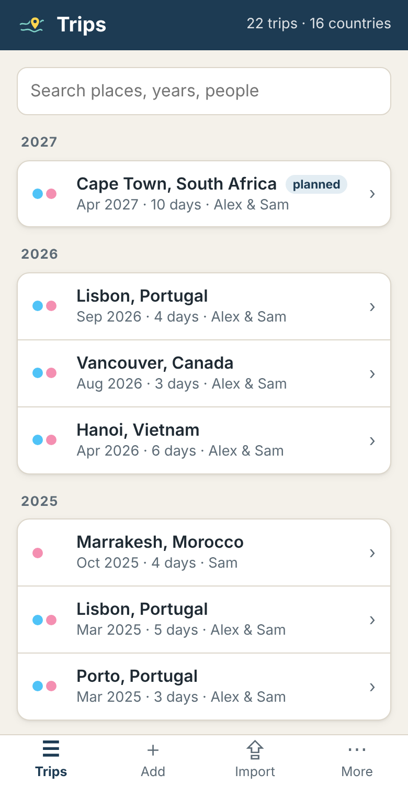

# MMM-WorldMapTravelCollector

A [MagicMirror²](https://magicmirror.builders/) module that maps everywhere you've traveled, solo or together, with a notebook-style ledger of places and dates, travel stats, and a phone-friendly editor.

| Digital (for mirrors) | Analog (for TVs and frames) |
| --- | --- |
|  |  |

> **Status:** pre-release. The map, ledger, stats, both themes, the phone editor and the Google Sheets / Google Maps imports all work. See [CHANGELOG.md](CHANGELOG.md).

## Installation

```bash
cd ~/MagicMirror/modules
git clone https://github.com/I-dontknowwhatImdoing/MMM-WorldMapTravelCollector
cd MMM-WorldMapTravelCollector
npm install --omit=dev
```

Add the module to `config/config.js`:

```javascript
{
	module: "MMM-WorldMapTravelCollector",
	position: "fullscreen_below",
	config: {
		travelers: [
			{ name: "Alex", color: "#4FC3F7" },
			{ name: "Sam", color: "#F48FB1" }
		]
	}
},
```

Restart MagicMirror, then add your trips from your phone with the [trip editor](#the-trip-editor), or put them in `data/trips.json` / `data/trips.csv` yourself (see [Trip data](#trip-data)). The mirror picks up changes within a second. No restart is needed.

To update later: `git pull && npm install --omit=dev`, then restart MagicMirror. Your `data/trips.json` is never touched by updates.

## Options

| Option | Default | Description |
| --- | --- | --- |
| `travelers` | `[]` | Who travels: `{ name, color }` per person, or just names |
| `togetherColor` | `"#FFD54F"` | Color for trips everyone took together |
| `home` | `null` | `{ city: "Boston", country: "US" }` or `{ lat, lon }`. Needed for the distance stat |
| `theme` | `"digital"` | `"digital"` (light lines on black, for mirrors) or `"analog"` (paper and ink, for TVs and frames) |
| `layout` | `"fullscreen"` | `"fullscreen"` (use a `fullscreen_below`/`fullscreen_above` position) or `"centered"` (any position) |
| `maxWidth`, `maxHeight` | `"90%"`, `"80%"` | Size when `layout` is `"centered"`. Percentages are of the screen |
| `projection` | `"equalEarth"` | The map's shape: `"equalEarth"` (curved edges, true sizes), `"naturalEarth"` (less curved), `"equirectangular"` (a flat rectangle that fills the width) or `"mercator"` (flat, but countries near the poles look much bigger) |
| `hideAntarctica` | `true` | Leave Antarctica off the map |
| `filters` | `["all", "together", "solo"]` | Views to offer. `"solo"` adds one per traveler; `"person"` adds "every trip with this person" |
| `defaultFilter` | `"all"` | View to start on, e.g. `"together"` or `"solo:Sam"` |
| `rotateInterval` | `30` | Seconds between views. `0` turns rotation off |
| `touchPause` | `120` | Seconds rotation pauses after a tap or a command |
| `details` | `true` | Tap (or click) a pin or a country to see its trips: when, how many days, who went, notes, and for a country the number of trips and cities, first and latest visit |
| `detailsTimeout` | `20` | Seconds before the details card closes by itself. `0` keeps it open until you tap × or somewhere else |
| `showLegend` | `true` | Show the view chips (they double as the color key) |
| `showStats` | `true` | Show the stats line |
| `stats` | all six | Which stats, in order: `"countries"`, `"cities"`, `"continents"`, `"worldPercent"`, `"tripsThisYear"`, `"distance"` |
| `worldCountryCount` | `195` | What "% of the world" divides by |
| `distanceUnits` | `"km"` | `"km"` or `"mi"` |
| `showPlanned` | `true` | Show future trips as dashed outlines and hollow pins |
| `highlightNewest` | `true` | Gently pulse the most recent trip |
| `fadeByAge` | `false` | Draw places you visited long ago fainter, and recent ones in full color |
| `fadeStrength` | `0.6` | How much the oldest places fade: `0` is no fading, `0.95` almost hides them |
| `fadeYears` | `10` | How many years it takes to reach the full fade. Places visited this long ago or longer all look the same |
| `animations` | `true` | Turn off all motion |
| `showProblems` | `true` | Show a note when rows in your trips file were skipped |
| `dataDir` | module's `data/` | Folder holding `trips.json` / `trips.csv` |
| `sheetUrl` | `""` | A Google Sheet to read trips from (see [Google Sheet](#google-sheet)) |
| `sheetRefreshMinutes` | `30` | How often the sheet is checked |
| `editor` | `true` | Serve the [trip editor](#the-trip-editor). `false` turns it off |
| `editorPin` | `""` | A PIN the editor asks for. Empty means no PIN |
| `homeRadiusKm` | `50` | Timeline imports leave out visits this close to `home` |
| `ledger` | see below | The list of places under the map |

`ledger` options (you only need to give the ones you change):

| Option | Default | Description |
| --- | --- | --- |
| `enabled` | `true` | Show the ledger |
| `rows`, `columns` | `5`, `4` | Grid size. On a portrait mirror try `rows: 11, columns: 2` |
| `sort` | `"newest"` | `"newest"`, `"oldest"` or `"alpha"` |
| `overflow` | `"cycle"` | When trips don't fit: `"cycle"` turns pages, `"shrink"` makes the text smaller |
| `pageInterval` | `15` | Seconds per page, for `"cycle"` |
| `minFontSize` | `10` | Smallest text in pixels, for `"shrink"`. Anything that still doesn't fit becomes "+N more" |
| `travelerMarker` | `"dots"` | `"dots"`, `"initials"`, `"color"` (tints the place name) or `"none"` |
| `showCountry` | `true` | "Lisbon, Portugal" or just "Lisbon" |
| `showDays` | `false` | Add the days spent, e.g. "5d" |
| `dateFormat` | `"MMM YYYY"` | Tokens: `YYYY`, `YY`, `MMMM` (March), `MMM` (Mar), `MM` (03), `M` (3). Month names follow MagicMirror's `language` |
| `showPlanned` | `false` | Include future trips in the ledger |

## The trip editor

Add, change and delete trips from your phone. The mirror serves the editor itself, so there's nothing else to install:

```
http://<your mirror's address>:8080/MMM-WorldMapTravelCollector/
```

| Trips | Add a trip | Import a Timeline |
| --- | --- | --- |
|  |  |  |

- **Trips**: every trip, newest first, with search. Tap one to change or delete it. Rows that can't be shown on the mirror (a typo in a city, say) are listed at the top so you can fix them.
- **Add**: pick the country, start typing the city and choose it from the list, then the month and who went. The same city and month as an existing trip is combined with it, so if you each add Lisbon, March 2025, it becomes a together trip.
- **Import**: Google Maps Timeline, saved places, My Maps and spreadsheets (see [Importing](#importing-from-google-maps-and-spreadsheets)). You check everything before it's saved.
- **More**: download all trips as a spreadsheet, and put back one of the last 10 versions of your list.

### Opening the editor from your phone

Out of the box, MagicMirror only answers the Pi itself. To use the editor from a phone on your home Wi-Fi, change two settings at the top of `config/config.js` (not inside the module's config):

```javascript
let config = {
	address: "0.0.0.0", // listen on the network, not just the Pi
	port: 8080,
	ipWhitelist: ["127.0.0.1", "::ffff:127.0.0.1", "::1", "::ffff:192.168.1.1/120", "192.168.1.1/24"], // the Pi plus your home network
	// ...
```

Use your own network in place of `192.168.1.1` (both times): if your phone's address is `192.168.0.23`, use `192.168.0.1`. To find the mirror's address, run `hostname -I` on the Pi. Restart MagicMirror after the change.

This only opens the mirror to devices on your home network. Don't forward port 8080 on your router: that would put your mirror on the internet. If others use your Wi-Fi, set `editorPin: "1234"` (your own number) in the module's config, and the editor will ask for it once per phone. Five wrong tries lock it for a minute.

Every change keeps a backup of the list from before (the last 10 are kept in `data/backups/`), and the editor can put any of them back.

## Importing from Google Maps and spreadsheets

In the editor, open **Import**, tap whose trips these are, and choose the file. Nothing is saved until you've reviewed the list and tapped **Save**.

| What | How to get the file | What you get |
| --- | --- | --- |
| **Google Maps Timeline** (Android) | Phone Settings → Location → Location services → Timeline → **Export Timeline data** | One trip per city and month, with the days you were there. Visits within `homeRadiusKm` of `home` are left out, and stops under 2 hours (often layovers) start unticked |
| **Google Maps Timeline** (iPhone) | Google Maps app → your picture → Settings → Personal content → **Export Timeline data** | Same as above |
| **Older Timeline history** | [Google Takeout](https://takeout.google.com) → Location History. Upload the whole zip or the `Semantic Location History` files | Same as above |
| **Saved and starred places** | [Google Takeout](https://takeout.google.com) → "Maps (your places)" and "Saved". Upload the zip | One trip per city, without dates: set the month in the review (for one row or all at once). Places from a "Want to go" list start unticked |
| **Google My Maps** | Open the map → ⋮ → **Export to KML/KMZ** | Same as saved places |
| **A spreadsheet** | Save it as CSV | Columns are matched by name (city, country, date, who, …), and you can match the rest by hand |

**Two people, one map:** import each person's Timeline separately and tap their name each time. Trips to the same city in the same month are combined into one together trip.

If `home` isn't set in your config, the Timeline import guesses it from where you spent the most time and tells you which city it picked.

## Google Sheet

Keep your trips in a Google Sheet instead of (or as well as) the editor. Use the same columns as [Trip data](#trip-data): `city`, `country`, `date`, `travelers`, and optionally `days`, `lat`, `lon`, `note`.

1. In Google Sheets: **File → Share → Publish to web**. Pick the sheet with your trips, choose **Comma-separated values (.csv)**, and click **Publish**.
2. Copy the link it shows and put it in the module's config:

	```javascript
	sheetUrl: "https://docs.google.com/spreadsheets/d/e/2PACX-.../pub?output=csv",
	```

The mirror checks the sheet every `sheetRefreshMinutes` (30 by default), and the editor's **More** tab has a **Check the sheet now** button. Sheet trips show in the editor with a lock: change them in the sheet. The last copy is kept in `data/sheet-cache.csv`, so the mirror still shows them after a restart without internet. A normal sharing link also works if the sheet is shared as "Anyone with the link".

If something's wrong (the sheet isn't published, the link is mistyped), the mirror says so in small text under the ledger.

## Controlling it from other modules

Other modules (remote control, buttons, voice) can send these notifications:

| Notification | Payload | Effect |
| --- | --- | --- |
| `WMTC_SET_FILTER` | `"together"` or `{ filter: "solo:Sam" }` | Switch view |
| `WMTC_NEXT_FILTER`, `WMTC_PREV_FILTER` | none | Next or previous view |
| `WMTC_NEXT_PAGE` | none | Turn the ledger page |
| `WMTC_SET_THEME` | `"digital"` or `"analog"` | Switch theme |

On a touch screen, tap a view chip to switch views, or tap the ledger to turn the page. Tap a pin or a country on the map to see its trips; tap anywhere else to close the card. (The same works with a mouse in a browser.)

Colors and sizes are CSS variables, so you can restyle the module in `css/custom.css`:

```css
.wmtc {
	--wmtc-land: rgba(255, 255, 255, 0.08);
	--wmtc-visited-opacity: 0.5;
}

.wmtc-theme-analog {
	--wmtc-paper: #f4ead6;
}
```

## Trip data

Each row is one visit to one place. A two-city trip is two rows with the same month.

| Column | Required | Example | Notes |
| --- | --- | --- | --- |
| city | no | Lisbon | Leave blank for a country-level visit |
| country | yes | Portugal, PT or PRT | |
| date | yes | 2025-03 | Year and month. "March 2025" and full dates work too |
| days | no | 5 | Days spent there |
| travelers | yes | Alex; Sam | Names from your config. "both" or "all" means everyone |
| lat, lon | no | 33.66, -95.55 | Only needed for places the lookup can't find, or to pick a specific one (Paris, Texas) |
| note | no | Anniversary | |

A month after the current month counts as a planned trip.

See [data/trips.example.csv](data/trips.example.csv) for a sample.

### Importing a CSV from the command line

```bash
cd ~/MagicMirror/modules/MMM-WorldMapTravelCollector
node scripts/import.js my-trips.csv --travelers "Alex,Sam" --dry-run   # check only
node scripts/import.js my-trips.csv --travelers "Alex,Sam"             # save to data/trips.json
```

Rows that can't be read are listed with the reason and skipped. (The editor's **Import** tab does the same with a review screen, and also reads Google Maps files.) Duplicates (same place and month) are merged, and their travelers are combined.

## Development

```bash
npm install
npm test            # unit tests
npm run lint
npm run preview     # see the module in your browser at http://localhost:8099, no MagicMirror needed
npm run build:geo   # rebuild geo/ from the original data sources (maintainers only)
```

## Credits

- Country shapes: [Natural Earth](https://www.naturalearthdata.com/) (public domain) via [world-atlas](https://github.com/topojson/world-atlas) (ISC).
- Cities: [GeoNames](https://www.geonames.org/) (CC BY 4.0) via [all-the-cities](https://github.com/zeke/all-the-cities) (MIT).
- Fonts (Analog theme): [Patrick Hand](https://fonts.google.com/specimen/Patrick+Hand) and [IM Fell English](https://fonts.google.com/specimen/IM+Fell+English), SIL Open Font License 1.1 (see `fonts/`).
- Country codes and names: [i18n-iso-countries](https://github.com/michaelwittig/node-i18n-iso-countries) (MIT) and [countries-list](https://github.com/annexare/Countries) (MIT).

## License

MIT. See [LICENSE](LICENSE).
