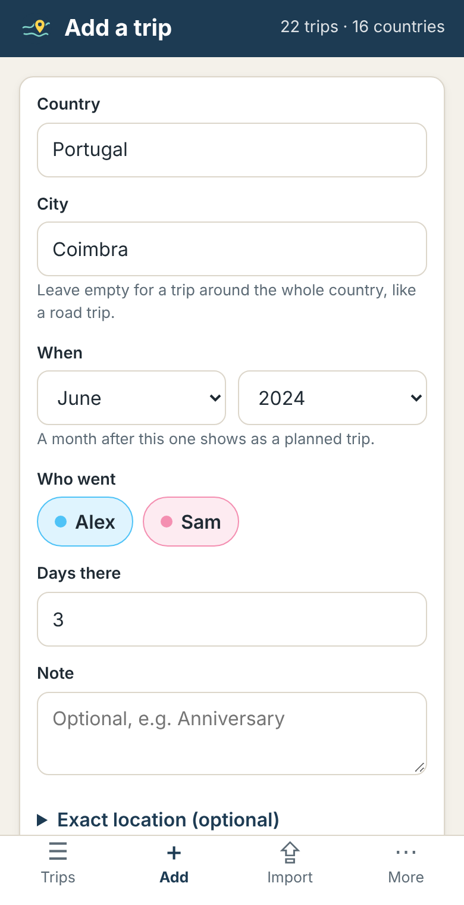
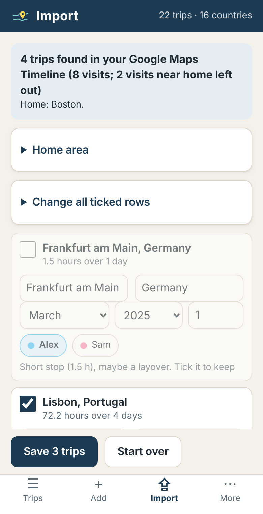

# MMM-WorldMapTravelCollector

A [MagicMirror²](https://magicmirror.builders/) module that maps everywhere you've traveled, solo or together, with a notebook-style ledger of places and dates, travel stats, and a trip editor you use from your phone.

| Digital (for mirrors) | Analog (for TVs and frames) |
| --- | --- |
|  |  |

- Countries you've visited are shaded, and each city gets a pin. Planned trips show as dashed outlines.
- Views for trips taken together, by each person, by year or by month, which take turns on the mirror.
- A ledger of places and dates, and a stats line: countries, cities, continents, share of the world, trips this year, distance.
- Add and fix trips from your phone, or import your Google Maps Timeline, saved places, My Maps or a spreadsheet. A Google Sheet works too.
- Works offline: the map and 135,000 cities are built in. Nothing about your trips leaves the mirror.

## Quick start

1. **Install** the module on the mirror (on a Raspberry Pi, in a terminal or over SSH):

	```bash
	cd ~/MagicMirror/modules
	git clone https://github.com/I-dontknowwhatImdoing/MMM-WorldMapTravelCollector
	cd MMM-WorldMapTravelCollector
	npm ci --omit=dev
	```

2. **Add it** to `~/MagicMirror/config/config.js`, inside `modules: [ ... ]`: paste it just after the `[`, so the comma at its end separates it from the next module. Change the names and the home city to yours:

	```javascript
	{
		module: "MMM-WorldMapTravelCollector",
		position: "fullscreen_below",
		config: {
			travelers: [
				{ name: "Alex", color: "#4FC3F7" },
				{ name: "Sam", color: "#F48FB1" },
			],
			home: { city: "Boston", country: "US" },
		},
	},
	```

	`fullscreen_below` fills the screen with the map, behind MagicMirror's other modules. If the clock or another module sits on top of the view buttons in the top left, move it to a `bottom_` position, or use one of the [ready-made setups](#ready-made-setups) that frames the map in the middle instead.

3. **Let your phone in.** MagicMirror only answers the mirror itself unless you change two settings at the top of the same file. See [Opening the editor from your phone](#opening-the-editor-from-your-phone).

4. **Restart MagicMirror**: `pm2 restart MagicMirror` if you start it with pm2; otherwise stop it (Ctrl+C in its terminal) and start it the way you usually do, or restart the Pi. The map says "Add trips from your phone" and shows a QR code. If the mirror stays blank instead, see [Troubleshooting](#troubleshooting).

5. **Scan the code** with your phone, on the same Wi-Fi, and add your first trip. The mirror updates within a second.

Needs Node.js 22 or newer (MagicMirror 2.38 and later need it anyway). Tested with MagicMirror 2.38 on a Raspberry Pi 4.

## Updating

```bash
cd ~/MagicMirror/modules/MMM-WorldMapTravelCollector
git pull
npm ci --omit=dev
```

Then restart MagicMirror. Updates never touch your trips (`data/trips.json`, `data/trips.csv`) or their backups. See [CHANGELOG.md](CHANGELOG.md) for what changed.

## Ready-made setups

Use one of these instead of the block from Quick start (replace it; don't add a second one), and change the names and home city to yours. Every line ends with a comma, so you can add more options under the last one. Every option is described under [Configuration](#configuration).

**A couple, on a mirror.** The next trip and days away in the stats, and a PIN for the editor:

```javascript
{
	module: "MMM-WorldMapTravelCollector",
	position: "fullscreen_below",
	config: {
		travelers: [
			{ name: "Alex", color: "#4FC3F7" },
			{ name: "Sam", color: "#F48FB1" },
		],
		home: { city: "Boston", country: "US" },
		stats: ["countries", "cities", "nextTrip", "daysTraveled"],
		editorPin: "2580",
	},
},
```

**One traveler, colored by year.** A view per year, and older places drawn fainter:

```javascript
{
	module: "MMM-WorldMapTravelCollector",
	position: "fullscreen_below",
	config: {
		travelers: ["Alex"],
		home: { city: "Toronto", country: "CA" },
		colorBy: "year",
		views: ["all", "years"],
		fadeByAge: true,
	},
},
```

**A portrait mirror.** Shows the days of each trip in the list, which fills the space under the map:

```javascript
{
	module: "MMM-WorldMapTravelCollector",
	position: "fullscreen_below",
	config: {
		travelers: [
			{ name: "Alex", color: "#4FC3F7" },
			{ name: "Sam", color: "#F48FB1" },
		],
		home: { city: "Boston", country: "US" },
		projection: "naturalEarth",
		ledger: { columns: 2, showDays: true },
	},
},
```

**A TV or picture frame.** Paper and ink, framed in the middle of the screen, colored by season:

```javascript
{
	module: "MMM-WorldMapTravelCollector",
	position: "middle_center",
	config: {
		travelers: [
			{ name: "Alex", color: "#4FC3F7" },
			{ name: "Sam", color: "#F48FB1" },
		],
		home: { city: "Boston", country: "US" },
		theme: "analog",
		layout: "centered",
		maxWidth: "85%",
		maxHeight: "85%",
		colorBy: "season",
	},
},
```

## Configuration

Everything is optional except `travelers`. Options go inside the module's `config: { ... }`, separated by commas.

Some options take a list, like `views` and `stats`. Write a list in square brackets, with each item in double quotes and commas between them, in the order you want: `stats: ["countries", "nextTrip", "daysTraveled"]`. A list replaces the default list completely, so include every item you want.

### People and colors

| Option | Default | Description |
| --- | --- | --- |
| `travelers` | `[]` | Who travels: `{ name: "Alex", color: "#4FC3F7" }` per person, or just names (`["Alex", "Sam"]`) and colors are picked for you |
| `togetherColor` | `"#FFD54F"` | Color for trips everyone took together |
| `colorBy` | `"auto"` | What the map's colors mean. `"auto"` follows the group on screen: people's colors for People, years for Years, months for Months. Or always one of: `"travelers"` (together, or each person's color), `"year"` (the year of the most recent visit), `"month"` (the calendar month of the most recent visit) or `"season"` (winter, spring, summer or autumn: 4 colors, the easiest to read) |
| `yearColors` | `"gradient"` | For `colorBy: "year"`: `"gradient"` (oldest to newest), `"distinct"` (a clearly different color each year; they repeat after 8 years), or your own colors for some years, e.g. `{ 2025: "#E57373" }` (other years use the gradient) |
| `yearGradient` | `["#5C6BC0", "#4DB6AC", "#FFD54F"]` | The gradient's colors, oldest year first. Two or more |
| `monthColors` | seasonal | For `colorBy: "month"`: 12 colors, January first. The built-in ones are chosen so people with red-green color blindness can tell every month apart |
| `seasonColors` | blue, green, yellow, orange | For `colorBy: "season"`: 4 colors, winter first |
| `hemisphere` | `"north"` | For `colorBy: "season"`: `"south"` makes December summer |

### Your trips

| Option | Default | Description |
| --- | --- | --- |
| `home` | `null` | Where you live: `{ city: "Boston", country: "US" }` (the country as a name or code: `"Portugal"` or `"PT"`) or `{ lat: 42.36, lon: -71.06 }`. Used for the distance stat, and to leave out places near home when importing a Timeline |
| `dataDir` | the module's `data/` folder | Folder holding `trips.json` / `trips.csv`. A relative path is relative to the module's folder |
| `sheetUrl` | `""` | A Google Sheet to read trips from (see [Google Sheet](#google-sheet)) |
| `sheetRefreshMinutes` | `30` | How often the sheet is checked |
| `showProblems` | `true` | Show a small note under the ledger when some trips couldn't be shown, e.g. "2 trips can't be shown. Open the trip editor to see why" |

### Map

| Option | Default | Description |
| --- | --- | --- |
| `theme` | `"digital"` | `"digital"` (light lines on black, for mirrors) or `"analog"` (paper and ink, for TVs and frames) |
| `contrast` | `"normal"` | `"high"` makes grey text and lines brighter, for dim mirrors or a room with daylight |
| `projection` | `"equalEarth"` | The map's shape: `"equalEarth"` (curved edges, true sizes), `"naturalEarth"` (less curved), `"equirectangular"` (a flat rectangle that fills the width) or `"mercator"` (flat, but countries near the poles look much bigger) |
| `hideAntarctica` | `true` | Leave Antarctica off the map |
| `layout` | `"fullscreen"` | `"fullscreen"` (use a `fullscreen_below` or `fullscreen_above` position) or `"centered"` (any position, sized by `maxWidth` and `maxHeight`) |
| `maxWidth`, `maxHeight` | `"90%"`, `"80%"` | Size when `layout` is `"centered"`. Percentages are of the screen; pixels (`"900px"`) work too |
| `showPlanned` | `true` | Show future trips as dashed outlines and hollow pins |
| `highlightNewest` | `true` | Gently pulse the most recent trip on the map, and mark it in the ledger |
| `animations` | `true` | `false` turns off all motion: the pulse on the newest trip and the fade when views change |

### Fading older trips

| Option | Default | Description |
| --- | --- | --- |
| `fadeByAge` | `false` | Draw places you visited long ago fainter, and recent ones in full color |
| `fadeStrength` | `0.6` | How much the oldest places fade: `0` is no fading, `0.95` almost hides them |
| `fadeUnit` | `"years"` | What `fadeAmount` counts: `"years"`, `"months"` or `"days"` |
| `fadeAmount` | `10` | How many years, months or days it takes to reach the full fade. Places visited this long ago or longer all look the same. With `"days"`, a trip without a start day counts as the 15th of its month |

### Views

| Option | Default | Description |
| --- | --- | --- |
| `views` | `["all", "together", "solo", "years", "months"]` | The views to offer, as a list in square brackets, e.g. `views: ["all", "years", "solo:Sam"]`. Choose from: `"all"`; `"together"` (trips everyone took); `"solo"` (one view per traveler: trips they took alone); `"person"` (one per traveler: every trip they were on); `"years"` (one per year with trips, newest first); `"months"` (one per calendar month: all your March trips, any year). Single ones work too: `"solo:Sam"`, `"person:Sam"`, `"year:2025"`, `"month:3"`. Before 1.0 this was called `filters`, which still works |
| `defaultView` | `"all"` | The view to start on, e.g. `"together"`, `"solo:Sam"` or `"year:2025"`. Before 1.0 this was `defaultFilter` |
| `viewGroups` | `true` | When the views come from more than one group, tabs before the view buttons switch between **People** (all, together, each person), **Years** and **Months**. Only the chosen group's buttons show, and the mirror takes turns through that group. `false` shows every view in one row and takes turns through all of them |
| `viewSwitcher` | `"auto"` | How views are offered: `"buttons"` (one per view), `"compact"` (one button showing the current view, with ‹ › either side and a dot per view) or `"auto"` (buttons while they fit on one line, compact when they don't) |
| `rotateInterval` | `30` | Seconds between views. `0` turns rotation off |
| `touchPause` | `120` | Seconds rotation pauses after a tap or a command from another module |
| `labels` | `{}` | Your own words for the view buttons, the group tabs and the season key. `{name}` stands for the person, year or month. The defaults: `{ all: "All", together: "Together", solo: "{name} only", person: "All of {name}'s", year: "{name}", month: "{name}", people: "People", years: "Years", months: "Months", winter: "Winter", spring: "Spring", summer: "Summer", autumn: "Autumn" }` |
| `showLegend` | `true` | `false` hides the view buttons and the color key. Views still take turns |

### Tapping the map

These matter on touch screens, or with a mouse. On a mirror without touch, everything can be read without tapping.

| Option | Default | Description |
| --- | --- | --- |
| `details` | `true` | Tap a pin or a country to see its trips: when, how many days, who went and notes; for a country, also the number of trips and cities and the first and latest visit |
| `detailsTimeout` | `20` | Seconds before the details card closes by itself. `0` keeps it open until you tap × or anywhere else |
| `detailsNotes` | `true` | Show trip notes on the details card. `false` keeps them off the mirror (guests can tap too) |
| `detailsHint` | `true` | On touch screens, show "Tap a place for details" under the map until the first tap |

You can also tap a view button to switch views, tap a place in the list under the map to see its card, and tap the page number under the list (1 / 2) to turn the page. A city's card has a "See all of …" link to the whole country.

### Stats

| Option | Default | Description |
| --- | --- | --- |
| `showStats` | `true` | Show the stats line |
| `stats` | the first six below | Which stats to show, in order, as a list in square brackets with each name in quotes, e.g. `stats: ["countries", "cities", "nextTrip", "daysTraveled"]`. The names are in the table below |
| `worldCountryCount` | `195` | What "% of the world" divides by |
| `distanceUnits` | `"km"` | `"km"` or `"mi"` |

Each stat counts the trips in the view on screen: in "Together", only trips you took together. Planned trips only count for `nextTrip`.

| Stat | Shows | Notes |
| --- | --- | --- |
| `"countries"` | 15 countries | Shown by default |
| `"cities"` | 19 cities | Shown by default |
| `"continents"` | 6/7 continents | Shown by default |
| `"worldPercent"` | 8% of the world | Countries visited out of `worldCountryCount`. Shown by default |
| `"tripsThisYear"` | 3 trips in 2026 | Shown by default |
| `"distance"` | 262,800 km traveled | A round trip from `home` to every place you visited, as the crow flies. Shown by default when `home` is set |
| `"daysTraveled"` | 142 days traveled | The days of every visit that has them |
| `"nextTrip"` | Next: Tokyo in 23 days | The soonest planned trip; days to go when it has a start day, else months |
| `"lastTrip"` | Last: Lisbon 3 months ago | The most recent visit |
| `"farthest"` | Farthest: Sydney 16,242 km from home | Needs `home` |
| `"newThisYear"` | 2 new countries in 2026 | Countries you visited for the first time this year |
| `"mostVisited"` | Most visited: Portugal 6 visits | The country you've been to in the most different months; shown once one has 2 or more |
| `"longestTrip"` | Longest trip: 21 days in Japan | Days added up per country and month, so Tokyo and Kyoto in one trip count together |
| `"usStates"` | 12/50 US states | States with a city you visited in the United States |

A stat that can't be worked out yet (no planned trip, no days entered, no `home`) is left out of the line. Counts show 0 when there's nothing to count, e.g. "0 trips in 2026".

### Ledger

The list of places under the map. Set only what you want to change, e.g. `ledger: { columns: 2 }`.

| Option | Default | Description |
| --- | --- | --- |
| `enabled` | `true` | Show the ledger |
| `rows` | `"auto"` | Rows per page. `"auto"` is 5, or more on a tall (portrait) screen when there are trips to fill the space under the map |
| `columns` | `"auto"` | Columns per page. `"auto"` is 4, or 2 on a tall (portrait) screen so place names fit; or set a number |
| `sort` | `"newest"` | The order of the ledger, read down each column and then across: `"newest"` (the most recent trip first), `"oldest"` (your first trip first) or `"alpha"` (A to Z by city, or by country for country-only trips; repeat visits to the same place, newest first). Trips in the same month go A to Z |
| `overflow` | `"cycle"` | When trips don't fit: `"cycle"` turns pages, `"shrink"` makes the text smaller |
| `pageInterval` | `15` | Seconds per page, for `"cycle"` |
| `minFontSize` | `10` | Smallest text in pixels, for `"shrink"`. Anything that still doesn't fit becomes "+N more" |
| `travelerMarker` | `"dots"` | `"dots"`, `"initials"`, `"color"` (tints the place name) or `"none"` |
| `showCountry` | `true` | "Lisbon, Portugal" or just "Lisbon" |
| `showDays` | `false` | Add the days spent, e.g. "5d" |
| `dateFormat` | `"MMM YYYY"` | Tokens: `YYYY`, `YY`, `MMMM` (March), `MMM` (Mar), `MM` (03), `M` (3). Month names follow MagicMirror's `language` |
| `showPlanned` | `false` | Include future trips in the ledger |

### Editor and imports

| Option | Default | Description |
| --- | --- | --- |
| `editor` | `true` | Serve the [trip editor](#the-trip-editor). `false` turns it off |
| `editorPin` | `""` | A PIN the editor asks for, e.g. `"2580"`. Empty means no PIN |
| `editorHosts` | `[]` | The editor opens at IP addresses, `localhost` and local names (`magicmirror`, `mirror.local`, `.lan`, `.home`). List any other name you use for the mirror here, e.g. `["mirror.example.net"]` |
| `showEditorLink` | `"auto"` | "Add trips from your phone", with a QR code and the editor's address, on the map. `"auto"`: in the middle when there are no trips yet, and in a corner for the first 10 minutes after each start. `true`: always in the corner. `false`: never |
| `homeRadiusKm` | `50` | Timeline imports leave out visits this close to `home` |

## The trip editor

Add, change and delete trips from your phone. The mirror serves the editor itself, so there's nothing else to install:

```
http://<your mirror's address>:8080/MMM-WorldMapTravelCollector/
```

The mirror shows this address, with a QR code to scan, when there are no trips yet and for 10 minutes after each start (see `showEditorLink`). MagicMirror's log has it too (`Trip editor: http://…`).

| Trips | Add a trip | Import a Timeline |
| --- | --- | --- |
|  |  |  |

- **Trips**: every trip, newest first, with search. Tap one to change or delete it (a delete can be undone). Rows that can't be shown on the mirror (a typo in a city, say) are listed at the top so you can fix them.
- **Add**: pick the country, start typing the city and choose it from the list, then the month and who went. After saving, the country, month and people stay filled in for the next stop on the same trip. The same city and month as an existing trip is combined with it, so if you each add Lisbon, March 2025, it becomes a together trip.
- **Import**: Google Maps Timeline, saved places, My Maps and spreadsheets (see [Importing](#importing-from-google-maps-and-spreadsheets)). You check everything before it's saved.
- **More**: download all trips as a spreadsheet, and put back one of the last 10 versions of your list.

### Opening the editor from your phone

Out of the box, MagicMirror only answers the mirror itself, and a phone gets a bare "403" or "Forbidden". The mirror tells you when this is the case. To use the editor from a phone on your home Wi-Fi, change two settings at the top of `config/config.js` (not inside the module's config):

```javascript
let config = {
	address: "0.0.0.0", // listen on the network, not just the mirror
	port: 8080,
	ipWhitelist: ["127.0.0.1", "::ffff:127.0.0.1", "::1", "192.168.1.0/24", "::ffff:192.168.1.0/120"], // the mirror plus your home network
	// ...
```

Use your own home network in place of `192.168.1.0` (both times). The mirror shows its own address on the map until phones are let in ("This mirror's address: 192.168.0.37"); change its last number to 0 and use that, here `192.168.0.0`. You can also run `hostname -I` on the mirror and use the address that starts with `192.168.` or `10.`. Restart MagicMirror after the change.

This only opens the mirror to devices on your home network. Don't forward port 8080 on your router: that would put your mirror on the internet. If others use your Wi-Fi, set `editorPin` in the module's config, and the editor will ask for it once per phone. Five wrong tries lock it for a minute.

Every change keeps a backup of the list from before (the last 10, in `data/backups/`), and the editor can put any of them back.

## Importing from Google Maps and spreadsheets

In the editor, open **Import** and choose the file. A "Who went on these trips?" box sets the people for every row at once. Nothing is saved until you've reviewed the list and tapped **Save**. Files can be up to 200 MB.

| What | How to get the file | What you get |
| --- | --- | --- |
| **Google Maps Timeline** (Android) | Phone Settings → Location → Location services → Timeline → **Export Timeline data** | One trip per city and month, with the days you were there. Visits within `homeRadiusKm` of `home` are left out, and stops under 2 hours (often layovers) start unticked |
| **Google Maps Timeline** (iPhone) | Google Maps app → your picture → Settings → Personal content → **Export Timeline data** | Same as above |
| **Older Timeline history** | [Google Takeout](https://takeout.google.com) → Location History. Upload the whole zip or the `Semantic Location History` files | Same as above |
| **Saved and starred places** | [Google Takeout](https://takeout.google.com) → "Maps (your places)" and "Saved". Upload the zip | One trip per city, without dates: set the month in the review (for one row or all at once). Places from a "Want to go" list start unticked |
| **Google My Maps** | Open the map → ⋮ → **Export to KML/KMZ** | Same as saved places |
| **A spreadsheet** | Save it as CSV | Columns are matched by name (city, country, date, who, …), and you can match the rest by hand |

**Two people, one map:** import each person's Timeline separately and pick their name each time. Trips to the same city in the same month are combined into one together trip.

If `home` isn't set in your config, the Timeline import guesses it from where you spent the most time and tells you which city it picked.

## Google Sheet

Keep your trips in a Google Sheet instead of (or as well as) the editor. Use the same columns as [Trip data](#trip-data): `city`, `country`, `date`, `travelers`, and optionally `start`, `days`, `lat`, `lon`, `note`.

1. In Google Sheets: **File → Share → Publish to web**. Pick the sheet with your trips, choose **Comma-separated values (.csv)**, and click **Publish**.
2. Copy the link it shows and put it in the module's config:

	```javascript
	sheetUrl: "https://docs.google.com/spreadsheets/d/e/2PACX-.../pub?output=csv",
	```

The mirror checks the sheet every `sheetRefreshMinutes` (30 by default), and the editor's **More** tab has a **Check the sheet now** button. Sheet trips show in the editor with a lock: change them in the sheet. The last copy is kept in `data/sheet-cache.csv`, so the mirror still shows them after a restart without internet. A normal sharing link also works if the sheet is shared as "Anyone with the link".

A published sheet can be read by anyone who has its link. Use the editor instead if that matters to you.

If something's wrong (the sheet isn't published, the link is mistyped), the mirror says so in small text under the ledger.

## Trip data

The editor writes `data/trips.json` for you. You can also write `data/trips.csv` (or `trips.json`) yourself: each row is one visit to one place, so a two-city trip is two rows with the same month.

| Column | Required | Example | Notes |
| --- | --- | --- | --- |
| city | no | Lisbon | Leave blank for a country-level visit |
| country | yes | Portugal, PT or PRT | |
| date | yes* | 2025-03 | Year and month. "March 2025" works too, and a full date (2025-03-14) also sets the start |
| start | no | 2025-03-14 | The day you arrived. With `days`, the map knows when the trip ended: the details card shows "14–18 Mar 2025" and fading counts from the end. *With a start, `date` can be left out |
| days | no | 5 | Days spent there |
| travelers | yes | Alex; Sam | Names from your config, separated by `;`, `,`, `&` or "and". "all", "both", "everyone", "together" or "us" means everyone |
| lat, lon | no | 33.66, -95.55 | Only needed for places the lookup can't find, or to pick a specific one (Paris, Texas) |
| note | no | Anniversary | Shown on the details card (see `detailsNotes`) |

A month after the current one counts as a planned trip. Google Maps Timeline imports fill in `start` and `days` for you. Changes to the files show on the mirror within a second; no restart is needed. See [data/trips.example.csv](data/trips.example.csv) for a sample. The editor's **Trips** tab has a button to move the trips in `trips.csv` into the editor.

To import a CSV from the command line instead:

```bash
cd ~/MagicMirror/modules/MMM-WorldMapTravelCollector
node scripts/import.js my-trips.csv --travelers "Alex,Sam" --dry-run   # check only
node scripts/import.js my-trips.csv --travelers "Alex,Sam"             # save to data/trips.json
```

## Controlling it from other modules

Other modules (remote controls, buttons, voice) can send these notifications:

| Notification | Payload | Effect |
| --- | --- | --- |
| `WMTC_SET_VIEW` | `"together"` or `{ view: "solo:Sam" }` | Switch view |
| `WMTC_NEXT_VIEW`, `WMTC_PREV_VIEW` | none | Next or previous view |
| `WMTC_NEXT_PAGE` | none | Turn the ledger page |
| `WMTC_SET_THEME` | `"digital"`, `"analog"` or `{ theme: "analog" }` | Switch theme |

The names from before 1.0 (`WMTC_SET_FILTER` with `{ filter: … }`, `WMTC_NEXT_FILTER`, `WMTC_PREV_FILTER`) still work. Rotation pauses for `touchPause` seconds after a command.

## Restyling

Colors and sizes are CSS variables, so you can restyle the module in MagicMirror's `css/custom.css`:

```css
.wmtc {
	--wmtc-land: rgba(255, 255, 255, 0.08);
	--wmtc-visited-opacity: 0.5;
}

.wmtc-theme-analog {
	--wmtc-paper: #f4ead6;
}
```

## Good to know

**Using the module twice** (on two pages, say): give both the same `dataDir`, or leave it out, so trips added in the editor show on both. The editor edits the trips of the instance that started last.

**Privacy.** Your trips stay on the mirror, in `data/`. The module only goes online to read a Google Sheet, if you set one. The editor is open to anyone on your home Wi-Fi unless you set `editorPin`. Notes show on the details card when someone taps a place; set `detailsNotes: false` to keep them off the mirror.

**Offline.** The map and the city list are built in, so the module works without internet. A Google Sheet shows its last saved copy until the mirror is back online.

**Touch screens.** Nothing needs a tap: views take turns by themselves and the ledger turns its pages. With touch, you can also tap places for details, tap a view button, tap a place in the list, and tap the page number to turn the page.

**Backups.** Copy the module's `data/` folder somewhere safe now and then; it holds your trips and the editor's last 10 backups. The editor's **More** tab can also download everything as a spreadsheet.

**Uninstalling.** Take the module's block out of `config/config.js`, restart MagicMirror, then delete `~/MagicMirror/modules/MMM-WorldMapTravelCollector` (keep a copy of its `data/` folder if you might want your trips again).

## Troubleshooting

**The mirror is blank or shows an error after editing config.js.** Usually a missing comma or bracket. Run `cd ~/MagicMirror && npm run config:check`: it names the line with the mistake. Each module's block is `{ ... },` with a comma after the closing `}`, and so is every option line inside `config: { ... }`.

**The phone shows "403" or "Forbidden".** MagicMirror only lets the mirror itself in. See [Opening the editor from your phone](#opening-the-editor-from-your-phone). If you've already changed `address` and `ipWhitelist`, check that you restarted MagicMirror and that the numbers match your home network (the mirror's address with its last number replaced by 0).

**The phone can't reach the page at all.** Check that the phone is on the same Wi-Fi as the mirror, and use the address the mirror shows (or run `hostname -I` on it); the port is usually 8080.

**"The editor only opens at the mirror's own address".** You used a name the editor doesn't know. Use the mirror's IP address, or add the name to `editorHosts`.

**The map says "2 trips can't be shown".** Some trips couldn't be shown, often a misspelled city or a traveler who isn't in `travelers`. Open the editor: they're listed at the top of **Trips** with what's wrong, and you can fix them there.

**A city isn't found.** The editor suggests close spellings. Very small places may not be in the list (it has places with 1,000 or more people): pick the nearest town, or add `lat` and `lon`.

**The map is empty or says "Couldn't load the world map".** The module's files are incomplete. Run `npm ci --omit=dev` in the module's folder and restart MagicMirror.

**Something else.** MagicMirror's log has messages from the module (`pm2 logs MagicMirror` if you use pm2). If you're stuck, [open an issue](https://github.com/I-dontknowwhatImdoing/MMM-WorldMapTravelCollector/issues) with what you see and the module's part of your config (without your PIN).

## Development

```bash
npm install
npm test            # unit tests
npm run lint
npm run preview     # see the module in your browser at http://localhost:8099, no MagicMirror needed
npm run build:geo   # rebuild geo/ from the original data sources (maintainers only)
```

## Credits

- Country shapes: [Natural Earth](https://www.naturalearthdata.com/) (public domain) via [world-atlas](https://github.com/topojson/world-atlas) (ISC).
- Cities: [GeoNames](https://www.geonames.org/) (CC BY 4.0) via [all-the-cities](https://github.com/zeke/all-the-cities) (MIT).
- Map drawing: [d3-geo](https://github.com/d3/d3-geo) and [d3-array](https://github.com/d3/d3-array) (ISC), and [topojson-client](https://github.com/topojson/topojson-client) (ISC).
- Reading KML files: [fast-xml-parser](https://github.com/NaturalIntelligence/fast-xml-parser) (MIT).
- QR codes: [qrcode-generator](https://github.com/kazuhikoarase/qrcode-generator) by Kazuhiko Arase (MIT).
- Fonts (Analog theme): [Patrick Hand](https://fonts.google.com/specimen/Patrick+Hand) and [IM Fell English](https://fonts.google.com/specimen/IM+Fell+English), SIL Open Font License 1.1 (see `fonts/`).
- Country codes and names: [i18n-iso-countries](https://github.com/michaelwittig/node-i18n-iso-countries) (MIT) and [countries-list](https://github.com/annexare/Countries) (MIT).

## License

MIT. See [LICENSE](LICENSE).
